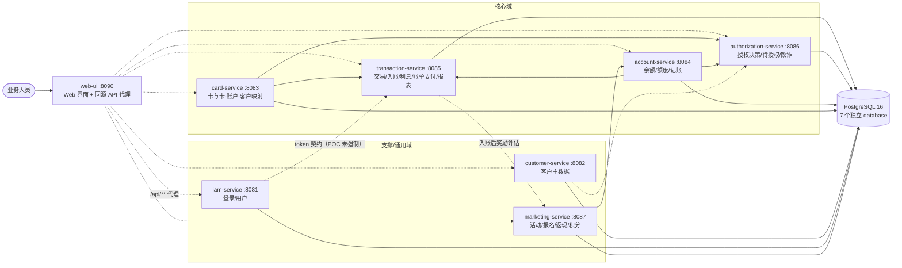

# CardDemo Java 微服务版（carddemo-java-1025）

把 AWS CardDemo（CICS/COBOL 信用卡核心演示系统）迁移为基于 **DDD 限界上下文**的 Java 微服务工程。
本项目不是逐行翻译 COBOL，而是：先提取存量业务知识（L1–L5 五层模型 + 业务规则目录），
再按领域边界划分 7 个微服务（6 个既有业务域 + 1 个新增营销支撑域），最后用 Spring Boot 3 落地，并提供面向业务人员的 Web 界面与
Docker Compose 调试运行能力。

## 1. 架构总览



| 服务 | 端口 | 数据库 | 对应遗留程序 |
|---|---|---|---|
| web-ui | 8090 → 容器 8080 | —（静态 SPA + 代理） | 对应 BMS 屏幕（COSGN00C/COMEN01C/COADM01C 等） |
| iam-service | 8081 | `carddemo_iam` | COSGN00C、COADM01C、COMEN01C、COUSR00C–03C |
| customer-service | 8082 | `carddemo_customer` | CUSTDAT、CBCUS01C、COACTUPC（客户部分） |
| card-service | 8083 | `carddemo_card` | CARDDAT、CCXREF、COCRDLIC/SLC/UPC |
| account-service | 8084 | `carddemo_account` | ACCTDAT、COACTVWC、COACTUPC（账户部分）、CBTRN02C 账户段、CBACT04C 结算、COBIL00C 扣款 |
| transaction-service | 8085 | `carddemo_transaction` | TRANSACT、DALYTRAN、TCATBALF、CBTRN01C/02C/03C、CBACT04C、COBIL00C、COTRN00C/01C/02C、CORPT00C、COTRTLIC |
| authorization-service | 8086 | `carddemo_authorization` | COPAUA0C、COPAUS0C/1C/2C、CBPAUP0C、IMS PAUTSUM0/PAUTDTL1、DB2 AUTHFRDS |
| marketing-service | 8087 | `carddemo_marketing` | **新增能力**（存量无营销）：活动、报名、返现/积分、活动效果 |

## 2. 目录结构

```
carddemo-java-1025/
├── pom.xml                      # Maven 聚合父 POM（Spring Boot 3.3.6 / Java 21）
├── docker-compose.yml           # PostgreSQL + 7 个微服务 + Web 界面
├── docker/postgres/init/        # 7 个 database 初始化
├── scripts/build-and-up.sh      # 打包 + 构建镜像 + 启动
├── scripts/smoke-test.sh        # 端到端冒烟测试
├── docs/
│   ├── legacy/                  # 存量知识：清单、五层模型、规则目录、数据字典、术语
│   ├── design/                  # DDD 设计：子域/上下文/拆分/API/追踪矩阵/ADR
│   └── ops/                     # Docker 运行与调试手册
└── services/
    ├── iam-service/
    ├── customer-service/
    ├── card-service/
    ├── account-service/
    ├── transaction-service/
    ├── authorization-service/
    ├── marketing-service/       # 营销：活动/报名/奖励/效果（新增）
    └── web-ui/                  # 业务界面（静态 SPA）+ 同源 API 代理
```

除 `web-ui` 外，每个 Java 微服务采用同一分层：

```
src/main/java/com/carddemo/<context>/
├── interfaces/rest   # Controller + DTO
├── application       # 用例编排、事务边界
├── domain            # 聚合根、领域服务、仓储端口、异常
└── infrastructure    # JPA 适配器、下游 REST 客户端、配置
```

## 3. 快速开始

前置：JDK 21、Maven 3.9+、Docker + Compose v2。

```bash
cd carddemo-java-1025
./scripts/build-and-up.sh          # mvn package + docker compose up -d --build
docker compose ps
./scripts/smoke-test.sh            # 端到端验证（健康、查询、入账、授权、报表）
```

打开 **http://localhost:8090/** 即为业务界面（登录账号已预填，直接登录）。

> 当前环境的 Docker Hub 不可达，镜像基于本机已有的 `eclipse-temurin:21.0.8_9-jdk` 与
> `postgres:16-alpine` 构建，因此镜像构建前必须先在宿主机执行 `mvn package`（脚本已包含）。
> 如果你的网络可访问 Docker Hub，可将各服务 `Dockerfile` 的首行改为 `eclipse-temurin:21-jre`
> 并恢复多阶段构建。

全部单元/集成测试：

```bash
mvn test        # 197 个用例，H2 + Flyway，多模块并行
```

## 3.1 Web 界面（推荐）

打开 **http://localhost:8090/**（宿主机 8080 已被其他程序占用，故映射到 8090；容器内仍为 8080）。

| 页面 | 能力 | 对应遗留屏幕/程序 |
|---|---|---|
| 登录 | 账号已预填，管理员/普通用户切换 | COSGN00C |
| 首页 | 按角色展示可用功能入口 | COMEN01C / COADM01C |
| 账户视图 | 账户 + 客户 + 卡片组合展示、可用额度计算 | COACTVWC |
| 信用卡 | 按账户/客户筛选、分页、详情与维护（卡面名/状态/到期） | COCRDLIC / COCRDSLC / COCRDUPC |
| 交易查询 | 交易号前缀/卡号/账户过滤、分页、详情 | COTRN00C / COTRN01C |
| 交易录入 | 类型/类别联动选择、完整商户信息、自动生成交易号 | COTRN02C |
| 账单支付 | 查询欠款 → 确认 → 全额还款并回显新余额 | COBIL00C |
| 交易报表 | 日期区间统计、区间合计、按卡合计 | CORPT00C / CBTRN03C |
| 授权管理 | 待授权汇总、明细、标记欺诈、过期清理 | COPAUS0C/1C/2C、CBPAUP0C |
| 活动中心 | 查看可参与活动、资格原因、报名（营销新增） | 新增能力 |
| 我的奖励 | 返现/积分记录、状态、待入账重试（营销新增） | 新增能力 |
| 活动管理 | 新建、编辑草稿、发布/暂停/结束、效果指标（管理员） | 新增能力 |
| 用户管理 | 列表、新增、编辑、删除（仅管理员） | COUSR00C–03C |

| 演示账号 | 密码 | 类型 |
|---|---|---|
| `ADMIN001` | `admin123` | 管理员（已预填） |
| `USER0001` | `user1234` | 普通用户 |

前端为无构建依赖的原生 SPA（`services/web-ui/src/main/resources/static`），所有 `/api/**` 请求由
web-ui 同源代理到对应微服务，浏览器无需处理 CORS。界面不做敏感信息展示：卡号完整显示仅用于演示，
SSN 始终为掩码，CVV 不返回。

## 3.2 API 控制台（Swagger UI）

每个微服务的根路径会 302 到自己的 Swagger UI，可用于接口调试：

| 服务 | Swagger UI | OpenAPI |
|---|---|---|
| iam | http://localhost:8081/ | http://localhost:8081/v3/api-docs |
| customer | http://localhost:8082/ | http://localhost:8082/v3/api-docs |
| card | http://localhost:8083/ | http://localhost:8083/v3/api-docs |
| account | http://localhost:8084/ | http://localhost:8084/v3/api-docs |
| transaction | http://localhost:8085/ | http://localhost:8085/v3/api-docs |
| authorization | http://localhost:8086/ | http://localhost:8086/v3/api-docs |

登录接口 `POST /api/v1/auth/login` 的请求体已预填演示账号；交易、授权、账单支付、入账、利息等
接口也预填了真实演示数据。OpenAPI 描述由代码注解生成。

> 注意：Swagger UI 是**按服务**的 API 控制台；Web 界面（8090）才是面向业务人员的统一入口。
> POC 未强制校验 token（ADR-007），两个入口都只应在本机/隔离网络使用。

## 4. 关键业务场景（curl）

```bash
# 登录（管理员）
curl -s -X POST localhost:8081/api/v1/auth/login \
  -H 'Content-Type: application/json' \
  -d '{"userId":"admin001","password":"admin123"}'

# 账户 / 客户 / 卡（组合出遗留 COACTVWC 视图）
curl -s localhost:8084/api/v1/accounts/00000000001
curl -s localhost:8082/api/v1/customers/000000001
curl -s localhost:8083/api/v1/cards/by-account/00000000001

# 日终入账（卡 3344556677889900 → 账户 6）
curl -s -X POST localhost:8085/api/v1/postings -H 'Content-Type: application/json' -d '{
  "transactions":[{"transactionId":"0000000000000100","cardNumber":"3344556677889900",
  "typeCode":"01","categoryCode":"0001","source":"POS TERM","description":"Purchase",
  "amount":25.00,"originalTimestamp":"2026-10-25T10:15:00","merchantId":"800000001",
  "merchantName":"Smoke Test","merchantCity":"Springfield","merchantZip":"10001"}]}'

# 授权（账户 1：额度 2020、欠款 1940 → 可用 80）
curl -s -X POST localhost:8086/api/v1/authorizations -H 'Content-Type: application/json' -d '{
  "cardNumber":"0500024453765740","transactionAmount":50.00,
  "transactionId":"TXN000000000001","merchantName":"Corner Grocery"}'

# 账单支付（全额还款）
curl -s -X POST localhost:8085/api/v1/bill-payments -H 'Content-Type: application/json' \
  -d '{"accountId":"00000000001","confirm":true}'

# 交易报表（2026-09，闭区间）
curl -s "localhost:8085/api/v1/reports/transactions?startDate=2026-09-01&endDate=2026-09-30"
```

## 5. 设计要点

- **限界上下文优先**：账户与客户不再同事务更新（遗留 `COACTUPC` 一屏两聚合），账单支付由
  transaction-service 编排、account-service 执行扣款，授权上下文独立持有待授权汇总。见 ADR-001/004。
- **标识符零填充字符串 + BigDecimal**：`accountId` 11 位、`cardNumber` 16 位、`customerId` 9 位、
  `transactionId` 16 位；金额统一 `numeric(12,2)`。见 ADR-002。
- **每服务一库**：禁止跨库 JOIN，跨域只走 REST；下游 404 表示"不存在"、5xx/超时表示"无法判断"（失败关闭）。
- **乐观锁替代记录锁**：`@Version` 替代 `READ UPDATE` + 快照比对，冲突返回 409。见 ADR-006。
- **缺陷修复**（均有记录与测试）：CVV 不被卡维护覆盖、过期授权清理回退信用余额、
  可用额度同时扣减账户欠款与授权占用、密码 PBKDF2 存储。见规则目录中的 `NR-*`。
- **营销能力（新增）**：活动/报名/奖励独立成上下文；入账成功后同步评估奖励，失败只告警不回滚账务；
  返现由 account-service 以 `rewardId` 幂等入账，待入账可重试。见 `docs/design/08-marketing-capability.md` 与 ADR-009。

## 6. 文档

| 入口 | 说明 |
|---|---|
| [docs/README.md](docs/README.md) | 全部文档索引 |
| [docs/legacy/02-five-level-model.md](docs/legacy/02-five-level-model.md) | L1–L5 业务模型（带证据） |
| [docs/legacy/03-business-rule-catalog.md](docs/legacy/03-business-rule-catalog.md) | 业务规则 → 实现落点 → 状态 |
| [docs/design/02-bounded-contexts.md](docs/design/02-bounded-contexts.md) | 6 个限界上下文 |
| [docs/design/05-api-catalog.md](docs/design/05-api-catalog.md) | 全部 API 契约与种子数据 |
| [docs/design/06-traceability-matrix.md](docs/design/06-traceability-matrix.md) | 44 个遗留程序的去向（营销为新增能力） |
| [docs/design/08-marketing-capability.md](docs/design/08-marketing-capability.md) | 营销场景、领域模型、积分/返现规则与前后台改造 |
| [docs/design/adr/README.md](docs/design/adr/README.md) | 9 个架构决策 |
| [docs/ops/01-docker-runbook.md](docs/ops/01-docker-runbook.md) | Docker 调试运行手册 |

## 7. 已知限制（POC 范围）

1. **未强制鉴权**：iam 已签发 HMAC token，资源服务侧校验留待网关（ADR-007），
   Web 界面（8090）与各服务端口均不得暴露公网。
2. **无分布式事务**：账单支付/入账采用"本地事务 + 同步调用 + 幂等键"，Saga/Outbox 见 ADR-005。
3. **报表只迁移数据口径**，不迁移 133 字节打印排版；对账单/分行迁移/MQ 适配器为延后项。
4. **种子数据为归一化样例**：遗留 ASCII 数据存在 EBCDIC 过穿孔字符，真实迁移须按数据字典解码。
5. 单账户并发授权使用乐观锁，热点账户需重试；压测与分区方案待补（未解决项 U1）。
6. **营销为新增能力**：入账后同步评估（最坏 +2s，营销不可用不影响入账）；预算并发极端情况下可能超发 1 笔；
   积分仅记录、暂不支持兑换；活动叠加策略需业务确认（`08-marketing-capability.md` §8）。
