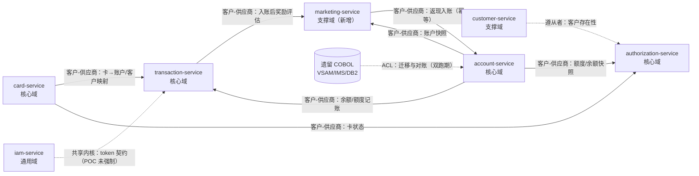

# 上下文映射（Context Map）

## 1. 映射关系

| 上游（Upstream） | 下游（Downstream） | 关系模式 | 集成方式 | 说明 |
|---|---|---|---|---|
| Card | Transaction | 客户-供应商（Customer-Supplier） | 同步 REST `GET /cards/{cardNumber}` | 交易需要卡→账户/客户映射；Card 保证契约稳定 |
| Account | Transaction | 客户-供应商 | 同步 REST `GET/POST /accounts/...` | 账户是余额权威；交易调用记账接口 |
| Card | Authorization | 客户-供应商 | 同步 REST | 授权需要卡状态与账户号 |
| Account | Authorization | 客户-供应商 | 同步 REST | 授权读取额度/余额快照，不写账户 |
| Customer | Authorization | 遵从者（Conformist） | 同步 REST | 仅校验客户存在；授权不修改客户 |
| Transaction | Marketing | 客户-供应商 | 同步 REST `POST /reward-evaluations` | 入账后触发奖励评估；营销失败不影响入账 |
| Account | Marketing | 客户-供应商 | 同步 REST `GET /accounts/{id}` | 营销读取账户组/状态判断资格 |
| Marketing | Account | 客户-供应商 | 同步 REST `POST /accounts/{id}/cashback-credits` | 返现由账户上下文执行，rewardId 幂等 |
| IAM | 全部服务 | 共享内核（仅 token 契约） | HTTP Header（规划） | POC 阶段不强制校验（ADR-007） |
| 遗留 COBOL 系统 | 新系统 | 防腐层（ACL，双跑期） | 文件/批量对账 | 迁移期数据由迁移工具转换，新系统不直接读 VSAM |
| Reporting（Transaction 内的子模块） | 调用方 | 开放主机服务（OHS） | REST 报表 API | 只读，不反向影响写模型 |

## 2. 关系图

## 3. 集成契约原则

1. **只共享 DTO，不共享实体**：下游不得反序列化上游的 JPA 实体（字段变更会连锁破坏）。
2. **上游不感知下游**：Account/Card 不知道 Transaction/Authorization 的存在，禁止回调。
3. **失败语义统一**：`404` 表示"实体不存在"（下游可转业务拒绝），`5xx/超时` 表示"无法判断"
   （下游必须失败关闭，不得当作不存在处理）。
4. **快照语义**：授权读取的账户余额是**某一时刻快照**，授权汇总在本地独立演进（ADR-003/004）。
5. **防腐层**：遗留数据（EBCDIC 过穿孔、定长记录）只允许在迁移工具中解码，新服务不接触原始字节。

## 4. 与遗留系统的映射（ACL）

| 遗留概念 | 新概念 | 转换责任 |
|---|---|---|
| `ACCT-CURR-BAL` | `Account.currentBalance`（欠款余额） | 迁移工具：解码过穿孔 → BigDecimal |
| `TRAN-CAT-BAL` | `TranCategoryBalance.balance` | 迁移工具 + 入账服务 |
| IMS `PAUTSUM0/PAUTDTL1` | `PendingAuthorizationSummary` / `AuthorizationCase` | 迁移工具：只迁移近期未过期授权 |
| `AUTHFRDS` | `AuthorizationCase`（同构） | 迁移工具：字段一一映射 |
| `SEC-USR-PWD` 明文 | `SecUser.passwordHash`（PBKDF2） | 迁移时强制重置密码或首次登录改密 |
| BMS 屏幕字段 | REST DTO + 前端 | 需前端重建，见 `05-api-catalog.md` |

## 5. 演进方向

- 引入 API 网关（ADR-007 方案 C）：统一鉴权、限流、路由。
- 交易事件外发（`TransactionPosted`）：报表与通知改为订阅，报表服务独立部署。
- 授权与账户之间的额度占用改为事件驱动（预授权占用/释放），降低同步依赖。
